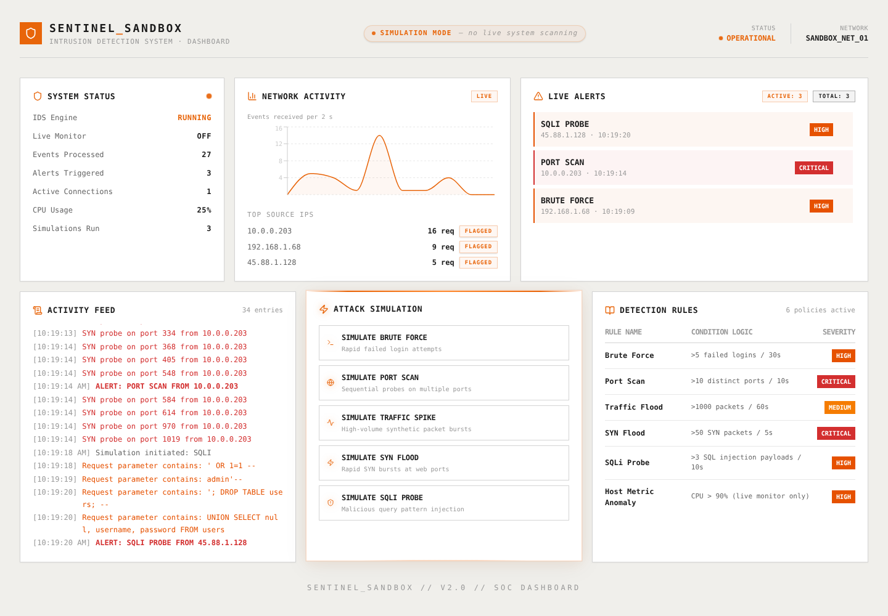

# Sentinel_Sandbox

[](https://github.com/Johndenisnyagah/sentinel_sandbox/actions/workflows/ci.yml)

An educational **attack simulator with a threshold-based detection engine** and a SOC-style dashboard. You trigger synthetic attacks; the simulator emits only telemetry events; a rule engine counts them per source IP in sliding time windows and raises the alerts.

It runs locally (two commands, see [Getting started](#getting-started)). There is no hosted demo: the free-tier backend slept when idle and was too slow to use, so it was taken down.



## What is real and what is simulated

| Part | Status |
|---|---|
| Attack simulations (5 types) | Synthetic data. Each emits a sequence of events (failed logins, port probes, packet bursts, SQLi payloads) from a random source IP. It never raises an alert itself. |
| Alerts | **Detected** by the rule engine (`app/engine/rules.py`) from those events. |
| Detection rules panel | The same rows the engine applies, read from the `rules` table. |
| Live packet sniffing (Scapy) and host monitoring (psutil) | Real, but **off by default**: sniffing needs root, so it starts only with `SENTINEL_LIVE_MONITOR=1`. Detects port scans (>10 distinct ports in 10 s) and CPU above 90 %. |
| Event-rate chart and status counts | Real: events received per 2 s, and counts from the database. |

## How detection works

Each rule names the event type it watches, a measure, a threshold and a window:

| Rule | Watches | Measure | Fires when, per source IP | Simulation sends |
|---|---|---|---|---|
| Brute Force | `failed_login` | count | more than 5 in 30 s | 8 |
| Port Scan | `connection_attempt` | distinct ports | more than 10 in 10 s | 15 |
| Traffic Flood | `traffic_burst` | sum of packets | more than 1000 in 60 s | 1200 |
| SYN Flood | `syn_burst` | sum of packets | more than 50 in 5 s | 80 |
| SQLi Probe | `suspicious_query` | count | more than 3 in 10 s | 4 |
| Host Metric Anomaly | (live monitor only) | CPU % | above 90 % | — |

Old events drop out of the window as time passes. A source's window is cleared after it fires, so one burst gives one alert. The simulations are sized above their thresholds so the demo is predictable; the tests check the boundaries instead (5 failed logins: no alert, 6: alert).

**Limits, stated plainly:** these are single-source threshold rules on synthetic events. They do not catch a scan spread across many IPs, a slow brute force below the window, or anything payload-based beyond the simulated SQLi events. Thresholds are illustrative, not tuned on real traffic. For log correlation across sources and ATT&CK mapping, see [soc-triage](https://github.com/Johndenisnyagah/soc-triage).

## Security controls

- **WebSocket Origin check.** CORS middleware does not apply to WebSockets, so the handshake checks `Origin` against `ALLOWED_ORIGINS` and refuses others with 1008 / HTTP 403 (cross-site WebSocket hijacking, CWE-1385).
- CORS allowlist from `ALLOWED_ORIGINS` (default: the local Vite origins, never `*`); credentials off.
- Parameterised SQL throughout.
- Live sniffing is opt-in (`SENTINEL_LIVE_MONITOR=1`) and off by default.

## Architecture

- **Backend (Python 3.12, FastAPI, SQLite):**
  - `main.py` serves the REST API (`/status`, `/alerts`, `/activity`, `/rules`, `POST /simulate`) and the `/ws/alerts` WebSocket.
  - `on_event` stores each event, broadcasts it and passes it to the rule engine.
  - `on_alert` is the one place that stores and broadcasts an alert.
- **Engines:** `app/engine/rules.py` (threshold rules over events) and `app/engine/detector.py` (opt-in Scapy/psutil monitor; alerts from its thread are handed to the server loop safely).
- **Frontend (React 19, Vite, Tailwind CSS v4, Recharts):** subscribes to the WebSocket and renders status, alerts, the activity feed, the rules and the simulation controls.

## Getting started

Prerequisites: Python 3.12 and Node.js 22 (what CI uses).

```bash
# Backend (http://localhost:8000)
cd backend
pip install -r requirements-dev.txt
python -m uvicorn main:app --reload

# Frontend (http://localhost:5173)
cd frontend
cp .env.example .env
npm install
npm run dev
```

Optional live monitor (Linux, root): `sudo SENTINEL_LIVE_MONITOR=1 python -m uvicorn main:app`.

## Tests

```bash
cd backend && pytest -q && ruff check .
cd frontend && npm run lint && npm run build
```

41 backend tests cover the rule engine (boundaries, sliding windows, reset, per-source tracking, each measure, schema migration), each simulation end to end, the live monitor's port-scan window and cross-thread alerts, the Origin check and the API. CI runs all of the above on every push and pull request.

## How this was built

Built with Claude Code as a pair programmer. I set the scope and reviewed each change, and the tests are the specification. The first version (March 2026) scripted its alerts. A portfolio audit in November 2026 found that, along with several bugs, and the fixes are in [CHANGELOG.md](CHANGELOG.md).

## Next steps (not built)

- Replay a public pcap through the same engine and compare its alerts with Suricata on the same file.
- Let the live monitor read its thresholds from the `rules` table instead of constants.

## License

MIT, see [LICENSE](LICENSE). Security reports: see [SECURITY.md](SECURITY.md).
